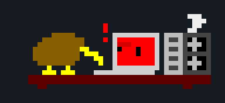

# terminal-pet

A pixel kiwi that codes, drinks coffee, handles computer disasters, and sleeps
under a breathing duvet—all in your terminal.



Run it by itself or above a working shell. The laptop displays, GPU activity,
downloads, and errors are decorative animations, not live system monitoring.
The pet runs locally and makes no API calls.

## Install and run

Kiwi requires Python **3.10 or newer**. On macOS with Homebrew, install
[pipx](https://pipx.pypa.io/) (which gives Kiwi its own Python environment)
and GNU Screen (for the shell beneath the pet):

```sh
brew install pipx screen
pipx ensurepath
```

Open a new terminal after `ensurepath`, then install from GitHub:

```sh
pipx install 'git+https://github.com/kenzeng24/terminal-pet.git'
kiwi
```

The GitHub command requires Git and a repository revision containing the packaging
files. If you have this checkout locally, install it instead:

```sh
pipx install .
```

Run that installation command from the project folder. Once installed, `kiwi`
works from any directory; no environment activation is needed. The package is
named `terminal-kiwi`, and its command is `kiwi`. It is not currently published
to PyPI.

```sh
kiwi              # pet above a working shell; type exit to close both panes
kiwi --pet        # pet only; press Ctrl+C to exit
kiwi --pet --design coffee
kiwi --help
```

Both launch modes default to the `daily` routine. Send `kiwi coffee`,
`kiwi sleep`, `kiwi wake`, or `kiwi random` from the shell beneath the pet,
or from another terminal if only one pet is running.

### Upgrade or uninstall

For a GitHub installation:

```sh
pipx upgrade terminal-kiwi
```

For a local installation, rerun `pipx install --force .` from the updated
checkout. Restart a running pet to use the new version.

```sh
pipx uninstall terminal-kiwi
```

### Install without pipx

You can also install into a dedicated Python environment:

```sh
python3 -m venv ~/.local/share/terminal-kiwi
~/.local/share/terminal-kiwi/bin/python -m pip install .
~/.local/share/terminal-kiwi/bin/kiwi --pet
```

Run the install command from this checkout. To use the short `kiwi` command,
add this line to your shell startup file (for example, `~/.zshrc`):

```sh
export PATH="$HOME/.local/share/terminal-kiwi/bin:$PATH"
```

Upgrade with the same environment's Python using `-m pip install --upgrade .`;
uninstall with `-m pip uninstall terminal-kiwi`.

### Run from source

No installation is needed to try the pet:

```sh
git clone https://github.com/kenzeng24/terminal-pet.git
cd terminal-pet
python3 kiwi_pet.py --pet
```

### Requirements

- Python 3.10 or newer; checked locally with Python **3.10.11**. No pip packages are required.
- An interactive terminal supporting ANSI colors, cursor positioning, and the
  alternate screen. The half-block renderer additionally needs Unicode block
  characters. Output redirection and notebook output cells are not supported.
- For the default mode, at least **42 columns × 9 rows** in pet-only mode, or
  **42 columns × 17 rows** with the split shell (half-block compact mode).
  Apple Terminal uses **84 × 18** or **84 × 26** smaller cells by halving the font. A larger window is more comfortable.
- **GNU Screen** (`screen` on your `PATH`) is required only for split-shell mode.

The project was developed on macOS. Linux and Windows/WSL compatibility have not
yet been verified; native Windows split-shell support is not provided.

## Keep working below the kiwi

Check that GNU Screen is available, then start the split-shell version:

```sh
command -v screen
python3 kiwi_pet.py
```

The animation occupies the top pane and an interactive shell runs below it.
Type `exit` in that shell to close both panes. If `screen` is unavailable, use
`--pet` or install GNU Screen through your system's package manager.

## Pixel size

Both sizes display the **same source artwork**, with every pixel preserved.
Size `1` makes each pixel approximately half as wide and half as tall as size `2`.

- **Apple Terminal:** size `1` temporarily halves the current tab's font size and
  draws the exact same background-colored spaces as size `2`. The original font
  size is restored when you exit. This affects the whole tab, including the shell
  in split-shell mode. Apple Terminal rounds font sizes to whole points (for example, 11 → 6 pt);
  an even starting size allows an exact half in points. Font metrics and screen
  pixels can still round the physical dimensions. macOS may ask for permission to control Terminal.
- **Other terminals:** size `1` packs two source rows into half-block characters,
  retaining all pixels without changing the font size.

No sprite reduction or resampling is used. To explicitly select the Apple
Terminal method, use `--renderer apple-font`; `--renderer half-block` selects the
Unicode method. If Terminal automation is unavailable, use size `2` and manually
reduce the tab's font size. Split-shell mode enables UTF-8 in GNU Screen.
Choose the size when launching either pet-only or split-shell mode:

```sh
python3 kiwi_pet.py --pet --pixel-size 1  # compact (default)
python3 kiwi_pet.py --pet --pixel-size 2  # original size
python3 kiwi_pet.py --pixel-size 1        # compact pet above your shell
```

Size `2` uses two columns and one row per pixel. The default daily scene then
needs **84 × 18** terminal cells, or **84 × 26** with the split shell.
Restart with the other option to switch sizes. Terminal font size also affects
the physical size on screen.

## Animation modes

Select a mode with `--design`:

```sh
python3 kiwi_pet.py --pet --design coffee
```

Omit `--pet` to use the same design above a working shell.

| Design | What happens |
| --- | --- |
| `daily` **(default)** | Two different daytime events, then sleep; includes recovery sequences, coffee breaks, and randomized nighttime screens. |
| `round` | The standing kiwi bobs at its laptop, with planted feet and spinning GPU fans. |
| `bedtime` | Repeats standing and sleeping, with pauses before breathing and after the last sleep bubble. |
| `sleep` | Sideways sleeping kiwi: the head stays still while the duvet breathes and bubbles rise. |
| `sleep_side` | The same sideways sleeping design as `sleep`. |
| `sleep_large` | A larger alternative sleeping kiwi with a breathing blanket. |
| `coffee` | The kiwi holds a green mug, contracts downward while sipping, and emits curling steam. |
| `reading` | The reading sprite turns pages of a green book beside the laptop. |
| `classic` | The original walking kiwi. |

```sh
python3 kiwi_pet.py --help
```

Most desk scenes need 39 terminal columns in half-block compact mode; `daily`
needs 42. Apple Terminal font scaling uses 78 and 84 columns respectively, with
smaller physical cells.
Original size uses 78 columns for most desk scenes and 84 for `daily`. Required height
varies by design. The program reports the required size if the window is too small.

## Preview page flipping

```sh
kiwi --book
# From a source checkout without installing:
python3 kiwi_pet.py --book
```

This loops the reading sprite on its own, without the laptop or a working shell.
The green outside cover faces you and stays fixed. The sheet turns behind it;
only the portion above the top edge is visible. The book keeps the same shape
throughout the animation, with a pause between page turns.

Use `kiwi --book-flat` (or `python3 kiwi_pet.py --book-flat`) to preview the flat
pose without motion. Both previews exit with **Ctrl+C**. Use
`--pixel-size 1 --renderer half-block` for a compact preview.

To see the same page flip beside the laptop, run `kiwi --pet --design reading`.
After updating a local installation, run `pipx install --force .` to pick up the change.

## Daily events

In `daily` mode, each simulated day has **two different events before one
night**. A simulated day lasts roughly 39–70 seconds at the default animation
speed, depending on the selected events and recovery sequences.

Currently enabled events are:

- Normal btop-style laptop activity.
- A blue screen with frozen fans and a startled kiwi.
- Overheating with smoke, a red display, and shutdown/restart recovery.
- Coffee while a download bar fills.
- A coffee break.
- Debugging that first fails, then succeeds.
- Rewriting a short red code block.

Code scrolling (`terminal`) and the one-pixel semicolon fix (`semicolon`) are
implemented but currently commented out in `DAY_LENGTHS`. Reading is available
as a standalone mode, but is not part of the random daily events.

The first day's activities and nighttime display are random too. There are no
preset opening days. Events do not repeat within a day or across day boundaries.

## Interact with the kiwi

Start the split-shell version, then type commands in the shell below it:

```sh
python3 kiwi_pet.py
# In the shell below the kiwi:
kiwi coffee  # drink coffee until another command
kiwi sleep   # sleep until another command
kiwi wake    # wake up and work at the laptop
kiwi random  # return to a fresh random daily routine
```

Commands take effect on the next animation tick (about 0.22 seconds). They control
only the kiwi above that shell. Starting the pet without an action defaults to
the random daily routine; `--design` still lets you choose an initial activity.

For pet-only mode, send commands from another terminal using the installed `kiwi`
command. If running from source without installing, use the project launcher:

```sh
./kiwi coffee
# Or make the command available in that shell, even after changing directory:
export PATH="$PWD:$PATH"
kiwi sleep
kiwi wake
kiwi random
```

A command from a separate terminal automatically finds a single running kiwi. If
several are running, use the shell beneath the intended kiwi. Commands report an
error if there is no running pet. Control uses local temporary files, with no
network or API calls, and the session files are removed when the pet exits.

## Customize the pet

Edit [kiwi_pet.py](kiwi_pet.py), then restart the animation:

- **Daily event pool:** comment or uncomment supported entries in `DAY_LENGTHS`.
  Keep at least two enabled.
  Adding an unfamiliar name alone does not implement a new event; it also needs
  rendering logic.
- **Nighttime options:** edit `NIGTHT_DISPLAYS` (the variable's current spelling).
- **Colors:** edit `COLORS`, `ROUND_COLORS`, and `SCREEN_COLORS`.
- **Pixel designs:** edit the sprite rows near the top of the file. Each character
  represents one pixel, rendered according to `--pixel-size`.
- **Timing:** the animation advances every 0.22 seconds. Event durations are in
  ticks; changing them also requires checking the event's internal phase timings.

The scrolling-code event reads this script's functions and classes once per run,
using their indentation, line lengths, and blank lines to build its pixel display.

### Refresh after editing

- **Pet only:** press Ctrl+C, then rerun the command.
- **Split shell:** type `exit`, then rerun the command from your original shell.

There is no automatic reload. Use the up-arrow key and Enter to repeat your last
command.

## Troubleshooting

- **“Run this pet in an interactive terminal.”** Run it directly in a terminal,
  without piping or redirecting its output.
- **Resize message:** enlarge the window or reduce your terminal font size.
- **Colors differ between modes:** pet-only mode uses a 256-color palette;
  split-shell mode uses a simpler ANSI palette to accommodate older Screen builds.
  Your terminal theme can also change the appearance of those colors.
- **Missing `screen`:** use `--pet`, or install GNU Screen for split-shell mode.
- **Cursor remains hidden after a forced termination:** run `reset` in your shell.

## Regenerate the demo GIF

The GIF renders a seeded example daily cycle at its normal animation speed.
Pillow is only needed to export it; the pet itself still has no dependencies.

```sh
python3 -m venv /tmp/kiwi-gif
/tmp/kiwi-gif/bin/pip install Pillow
/tmp/kiwi-gif/bin/python scripts/make_demo.py
```

## Rendering checks

Run `python3 -m unittest discover -s tests` to verify both sizes across all
animation modes, daily events, recovery phases, and nighttime displays with both
palettes. Tests cover source-pixel preservation, Apple Terminal font scaling and
restoration, detection, and failure handling. Interaction tests cover commands, session targeting,
cleanup, and random scheduling.

## Contributing

Bug reports and pull requests are welcome. For display issues, include your OS,
terminal application, Python version, chosen design, terminal dimensions, and a
screenshot if possible. Check both pet-only and split-shell behavior when changing
rendering or terminal handling.

## License

[Apache License 2.0](LICENSE).
